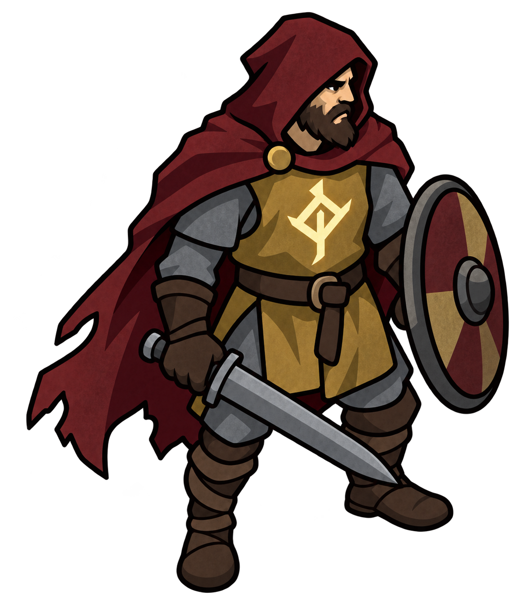

# Арт: еталон стилю

_30.10.2026 · VISION §10. Арт у грі з'являється, коли контент біому зафіксовано; до того — фігури кодом._



Усі промпти Лісового біому з нуля — [FOREST_PROMPTS.md](FOREST_PROMPTS.md); чого ще бракує — [NEEDED.md](NEEDED.md).

`heroes/warrior/reference.png` — **еталон стилю** (Воїн цілий). Прикріплюй його до кожної генерації зі словами «same style as the reference».

## Файли

У кожної істоти — своя папка: `reference.png` (одна фігура, якщо є) і `poses.png` (аркуш усіх поз — оригінал, з якого ріжуться кадри для гри).

```
heroes/     warrior/  mage/  archer/
mobs/       wolf/  mushroom/  stump/  spirit/  spider/
bosses/     alpha/  spinner/  enat/
npc/        lumberjack/
locations/  forest/   ground.png  obstacles.png  concept.png
            deep-forest/  webs.png
            lair/     ground.png  obstacles.png
fx/         fx.png  common.png  items.png  telegraphs.png  spore.png  warrior.png  mage.png  archer.png
ui/         signs.png
```

| Файл | Що це |
|---|---|
| `heroes/warrior/reference.png` | еталон стилю (Воїн цілий) |
| **`heroes/warrior/poses.png`** | **аркуш Воїна:** 3 × 6 — стояння, ходьба, вертикальний удар, горизонтальний удар, випад мечем, ривок щитом. У грі — `public/sprites/anim/warrior.png` |
| `heroes/mage/` | Маг: цілий і аркуш 3 × 6 — стояння, ходьба, каст уперед, каст над головою, канал, блимання. У грі — `public/sprites/anim/mage.png` (нарізка з `GRID=3x6`: кристал посоха торкається фігури рядом нижче) |
| `heroes/archer/` | Лучник: цілий і аркуш 3 × 6 — стояння, ходьба, постріл уперед, постріл угору, віяло, відскок. У грі — `public/sprites/anim/archer.png` (`GRID=3x6`) |
| `mobs/wolf/poses.png` | Вовк, 3 × 3: біг, присід / стрибок / приземлення з укусом, удар / падіння / мертвий. У грі — `public/sprites/anim/wolf.png` (`GRID=3x3`) |
| `mobs/mushroom/poses.png` | Гриб-плювака, 3 × 3: хода, набухання / плювок / відкат, удар / розпад / купка. У грі — `public/sprites/anim/mushroom.png` (`GRID=3x3`) |
| `mobs/stump/poses.png` | Пеньок, 3 × 3: хода, руки вгору / удар об землю / у тріщинах, удар / розколюється / купа трісок. У грі — `public/sprites/anim/stump.png` (`GRID=3x3`; тріщини від удару, що залізли в нижній ряд, стерто) |
| `mobs/spirit/poses.png` | Дух занепаду, 3 × 2: ширяння, набухання / випуск туману / втеча (дивиться ліворуч). У грі — `public/sprites/anim/spirit.png` (`GRID=3x2`) |
| `npc/lumberjack/poses.png` | Лісоруб, 3 × 2: наляканий, махає рукою, сокира напоготові; ходьба з сокирою на плечі. У грі — `public/sprites/anim/lumberjack.png` (`GRID=3x2`) |
| `mobs/spider/poses.png` | Павук, 3 × 3: біг, дибки / плювок павутиною / приземлення, удар / на спині / мертвий. У грі — `public/sprites/anim/spider.png` (`GRID=3x3`) |
| `bosses/spinner/poses.png` | Прядуха, 3 × 4: біг боком, дибки / плювок коконом / стягує нитки, виснажена / випускає павучат / удар, падає / на спині / мертва. У грі — `public/sprites/anim/spinner.png` (`GRID=3x4`) |
| `bosses/enat/poses.png` | Старий Енат, 3 × 4: дихання, руки вгору / удар / гілка-хапання, кам'яний / кам'яний з колючками / тріщини із соком, слабне / падає / лежить. У грі — `public/sprites/anim/enat.png` (`SCALE=1 GRID=3x4` — повний розмір, він великий) |
| `bosses/enat/ghost.png` | примара Ената; у грі — `public/sprites/anim/enat-ghost.png` (зменшена до 560 px) |
| `locations/deep-forest/webs.png` | кокон цілий / тріснутий / порваний, павутина на землі, дві павутини для крон, кокон і грудка павутини в польоті. У грі — атлас `public/sprites/web-props.png` (`cut-props.py`, `SCALE=0.5`) |
| `bosses/enat/fx.png` | удари Ената: коріння (тріщини / наполовину / повністю), кам'яний шип (тріщина / наполовину / повністю), ряд колючок, гілка-хапання, дві мохові брили. У грі — атлас `public/sprites/enat-fx.png` (`cut-props.py`, `SCALE=0.5`) |
| `locations/lair/ground.png` | земля лігва, безшовна; у грі — `public/sprites/lair-ground.jpg` (640 px) |
| `locations/lair/obstacles.png` | предмети лігва: три кореневі арки, два дупласті стовбури, три пні, два камені з рунами, кістки з рогами, сухе дерево з лишайником, зів'ялий кущ. У грі — атлас `public/sprites/lair-props.png` (`SCALE=0.65`); у лігві замість дерев — сухе дерево й арки, замість каменів — рунічні, орієнтири — пні й кістки (`LAIR_ART`) |
| `bosses/alpha/poses.png` | Ватажок зграї, 3 × 4: біг, ривок (присід, кидок, гальмування), стрибок (присід, політ, удар об землю), виття / задишка / удар. У грі — `public/sprites/anim/alpha.png` (`GRID=3x4`) |
| `locations/forest/ground.png` | безшовна текстура землі Лісу; у грі — `public/sprites/forest-ground.jpg` (зменшена до 640 px: одна плитка = 640 px світу) |
| `locations/forest/obstacles.png` | аркуш предметів Лісу: 3 ялини, 2 криві дерева, сухе дерево, Старий дуб, 3 кущі, 3 камені, стоячі камені, повалена сосна, лігво, святилище, вівтар, скриня, трава. У грі — атлас `public/sprites/forest-props.png`. Групи з двох і трьох стоячих каменів перекриваються й чисто не розрізаються — Кам'яне коло складене з одиночного каменя (дзеркально, різного розміру) |
| `locations/forest/concept.png` | концепт локації (лише орієнтир) |
| `locations/forest/scene.png` | сцена точки Лісу на карті: біженці виходять з лісу, герой спиною. У грі — `public/sprites/forest-scene.jpg` (1400 px), фон екрана точки Лісу |
| `fx/common.png` | ефекти на героєві, 3 × 3 (з'являється / на повну / тане): лікування листочками, золотий щит, стовп світла нового рівня. У грі — `public/sprites/anim/fx-common.png`, нарізка звичайною сіткою: `python scripts/cut-grid.py <аркуш> <атлас> <json> "0,450,834,1254" "0,405,821,1254"` (ефекти — розсип окремих шматків, контуром їх не ріжуть) |
| `fx/items.png` | кристал досвіду, монета, спора гриба. У грі — `public/sprites/anim/items.png` (`cut-grid.py`, `SCALE=0.2`, стовпці `0,740,1400,2172`); спора крутиться в польоті |
| `fx/telegraphs.png` | підказки атак на землі: смуга (подряпини-початок, середина, вістря) і коло — порожні й повні; зелене безпечне коло. У грі — `public/sprites/anim/telegraphs.png` (аркуш, зменшений удвічі); координати шматків — `TELEGRAPH_ART` (`src/data/forestArt.ts`) |
| `fx/spore.png` | спора гриба, 3 кадри пульсу. У грі — `public/sprites/anim/spore.png` (`cut-grid.py`, `SCALE=0.2`) |
| `ui/signs.png` | знак Берегині (життя): горить, згас, 3 кадри згасання. У грі — `public/sprites/ui-signs.png` (`cut-grid.py`, `SCALE=0.25`) |
| `fx/warrior.png`, `fx/mage.png`, `fx/archer.png` | автоатака: дуги вертикального й горизонтального удару, випад, іскра влучання; вогняна куля, вибух, спалах на посоху; стріла, стріла в землі, кільце повітря на луці. У грі — `public/sprites/anim/fx-<клас>.png` (`CLEAR=40 SCALE=0.5 cut-grid.py`: прибрано тьмяне сяйво довкола) |
| `fx/fx.png` | ефекти (слід удару, сяйво леза, спалах знака, іскра, кільце, пилюка) — оригінал; у грі — `public/sprites/anim/fx.png` |

Новий арт клади так само: герой — `heroes/<клас>/`, звір — `mobs/<звір>/`, бос — `bosses/<бос>/`, мирний персонаж — `npc/<хто>/`, земля й предмети — `locations/<локація>/`.

Звірі описані в `BEAST_SHEETS` (`src/data/beastAnim.ts`): які кадри — які пози, масштаб, тінь.

**Предмети — окремими шматками.** Аркуш, де предмети стоять окремо, ріжеться за контуром кожного й пакується в атлас; кожен шматок отримує точку ніг (середину трав'яної основи):

```
SCALE=0.65 python scripts/cut-props.py <аркуш> <атлас.png> <шматки.json> <прев'ю.png>
```

Шматки нумеруються рядами зліва направо; їхні номери, розміри у світі й складені предмети (Кам'яне коло — з трьох груп каменів) — у `FOREST_ART` (`src/data/forestArt.ts`).

**Анімація — покадрова.** Усі рухи персонажа генеруються **однією картинкою** — так персонаж однаковий у всіх кадрах і в однакових пропорціях. Скрипт вирізає кожен кадр за його контуром, розкладає по рядах за лінією ніг, вирівнює по ногах і центру тулуба й пакує в сітку однакових клітинок:

```
COLS=3 python scripts/pack-frames.py <аркуш> <атлас.png> <атлас.json> <прев'ю.png> "0-2:xy,3-5:xy75"
```

Які кадри — які рухи, скільки триває кожен і який скіл грає який рух — `HERO_SHEETS` у `src/data/heroAnim.ts` (по класу). Якщо фігури сусідніх рядів торкаються (посох, лук), додай `GRID=3x6`: аркуш ріжеться по найпорожніших лініях біля сітки, а відрізані кінчики повертаються своїй фігурі.

**Чого навчились:**
- кожен рух — **3 кадри** (початок, середина, кінець): генератор їх тримає однаковими, а більше кадрів дає «тупцювання» й повтори;
- ходьба — **3 кадри** (крок, ноги разом, інший крок), грається туди й назад; **у кадрах 1 і 3 спереду мають бути різні ноги** — перевір перед тим, як брати;
- **дихання й відкидання — кодом** (одна картинка), плавніше за перемикання майже однакових кадрів;
- генеруй усе **в одному чаті** з `heroes/warrior/reference.png` і попереднім аркушем як зразком пропорцій.

Промпт аркуша (3 × 6, вертикальна картинка; прикріпити `heroes/warrior/reference.png`):

```
Using exactly this character and style, with the SAME PROPORTIONS AND SCALE as the attached
walk sheet (same height, same leg length and thickness, same boots, cloak, shield and sword size),
draw one animation sprite sheet: a grid of 3 columns × 6 rows, 18 frames, PORTRAIT image.

Rules for every frame: facing right, three-quarter view, the same size and scale, one figure per
cell, centred, figures never touch or overlap, feet on the same ground line within each row,
identical design, colours and outlines. The sword is always in the right hand, the shield on the
left arm. No motion blur, no speed lines, no effects, no text, no grid lines,
fully transparent background.

Row 1 — STANDING: 1) relaxed ready stance, feet a little apart, sword held low pointing
down-forward; 2) the same, chest slightly raised (breathing in); 3) the same, shoulders slightly lower.
Row 2 — WALK (3 frames, a calm walk, feet at most a shoulder-width apart; both legs look the
same in every frame): 1) one leg in front, heel down, the other behind on its toes;
2) passing — one leg straight under the body, the other bent and passing it, foot just above the
ground; 3) the OTHER leg in front (the mirror of frame 1).
Row 3 — VERTICAL SLASH: 1) start — the sword raised high above the head, body leaning slightly
back; 2) middle — the sword coming down at shoulder height in front; 3) end — the sword low in
front near the ground, body leaning forward.
Row 4 — HORIZONTAL SLASH: 1) start — the sword pulled back behind the body at waist height;
2) middle — the sword straight out in front, horizontal, arm extended; 3) end — follow-through,
the sword swung across to the far side, arm across the chest.
Row 5 — SWORD LUNGE FORWARD: 1) start — knees bent, the sword pulled back at the hip, point
forward; 2) middle — lunging forward, front leg stepping out; 3) end — full lunge, front knee
bent deep, the sword thrust straight forward at full reach.
Row 6 — SHIELD DASH FORWARD: 1) start — crouched low behind the raised shield;
2) middle — charging forward behind the shield, body leaning far forward, back leg pushing off;
3) end — the shield thrust forward at full reach as at an impact, sword held back.
```

Для інших персонажів — той самий шаблон рядів зі своїми рухами (для ворогів — їхні атаки).

## Правила стилю

- **Чіткі товсті темні контури**, великі прості форми, пласкі кольори з одним тоном тіні, легка мальована фактура на великих площах. Дрібних деталей немає (кільця кольчуги, дірки, пряжки).
- **Має читатися при ~100 px** на екрані. Перевірка — зменшити й поставити на землю біому серед ворогів.
- **Вид — три чверті, обличчям праворуч**, прозорий фон, без тіні на землі.
- **Настрій темний, приглушений**, але не брудний.
- **Герой теплий** (вино-червоний, охра, золото знака), **вороги — холодні й темні кольори свого біому**, щоб героя було видно в будь-якому натовпі.
- **Знак Берегині — найяскравіша пляма** на героєві.
- **Анімація частинами:** голова, тулуб, плащ, руки, ноги, зброя — окремо. Один персонаж — один чат: спершу цілий, потім розклад на частини з тієї самої картинки.

## Промпт героя (ChatGPT)

```
2D game character sprite for a top-down action roguelite, three-quarter view
(camera tilted about 45 degrees), facing right, full body, idle standing pose.

Style: clean bold cartoon-like illustration with thick, even dark outlines
(like Don't Starve or Darkest Dungeon simplified), large simple shapes,
flat colours with only one shadow tone per colour, almost no texture,
no fine details. Must stay readable at 100 pixels tall.

Character: a foreign warrior from across the sea, sole survivor of a shipwreck,
in a dark Slavic folk-fantasy world. Hooded cloak, simple tunic over a plain mail shirt
(drawn as one solid grey shape, no ring pattern), a wide belt, wrapped boots,
a round shield and a short one-handed sword.
A large glowing rune-like sign on the chest — pale gold, clearly visible.

Colours: warm and contrasting so he stands out against green forest ground —
deep crimson cloak, warm ochre tunic, dark brown leather, grey steel,
pale gold glow. Slightly larger head and hands than realistic.

Strong clear silhouette. Fully transparent background, no ground shadow, no text.
```

Далі в тому самому чаті:

```
Keep exactly this design, outlines and simplicity, but make the mood darker and more somber:
desaturate the colours slightly (darker wine-red cloak, muted ochre tunic, darker steel),
add one soft shadow tone and a very light painted texture on large areas.
The glowing sign stays bright pale gold — it should be the brightest spot on the character.
Transparent background.
```
